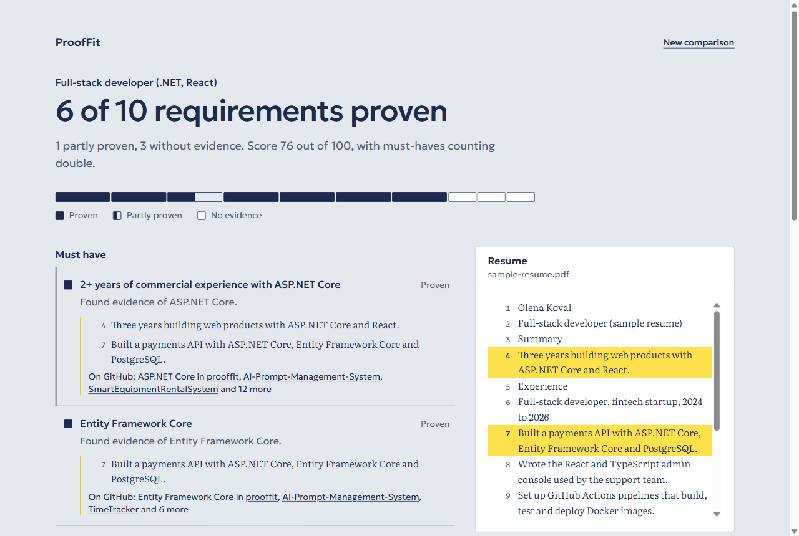
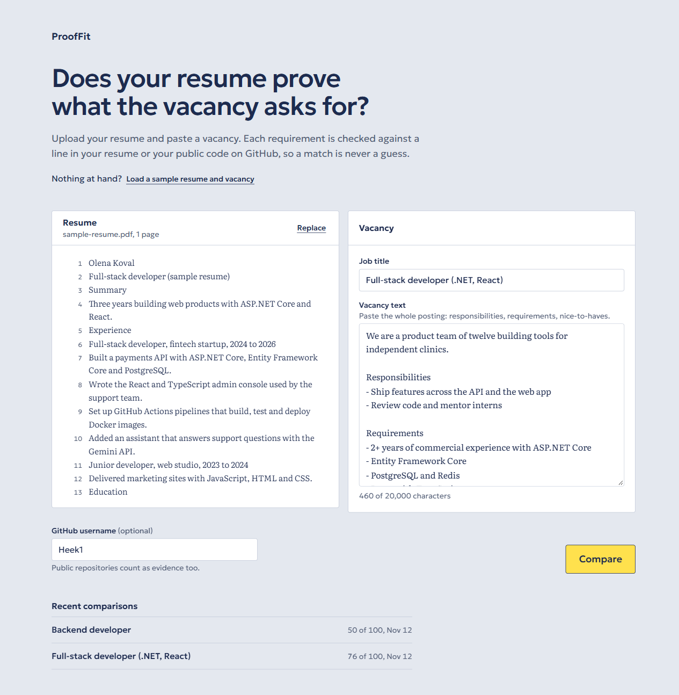
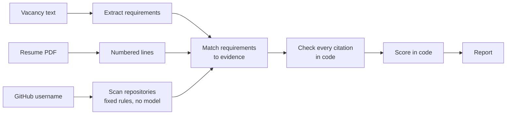

# ProofFit

**Does your resume prove what the vacancy asks for?**

ProofFit compares a resume with a job posting and backs every verdict with evidence. A
requirement counts as met only when the report can point at a line of the resume or at
something in the candidate's public GitHub repositories. The matcher proposes; plain code
checks the evidence and computes the score.



## What it does

- **Reads the vacancy** and lists what it requires, split into must-haves and nice-to-haves.
- **Reads the resume** from a PDF and keeps it as numbered lines, so evidence can be cited.
- **Scans a GitHub profile**, if a username is given, for the skills its public code shows.
- **Judges each requirement** as proven, partly proven or without evidence, with a one-line
  reason and the evidence quoted in place.
- **Scores the match** from 0 to 100, with must-haves counting double.

Choosing a requirement in the report marks the lines it cites in the resume and the facts it
cites from GitHub. A sample resume and vacancy are one click away on the start page.



## How it works



Two engines can do the extracting and matching:

- The **keyword engine** needs no model. It reads requirements from the headed bullet lists
  of a posting and looks for the technologies each one names. It is the default.
- The **model engine** asks a language model (Gemini) and is used when an API key is
  configured. If the model is unreachable or returns something unusable, the keyword engine
  finishes the analysis and the report says so.

Whichever engine runs, its verdicts are only proposals. `EvidenceValidator` drops any cited
resume line that does not exist and any GitHub fact that was never gathered, and a verdict
left with no evidence becomes "no evidence". A model cannot talk a requirement into the
report as met.

## Design decisions

- **Evidence is checked in code, not trusted.** This is the product's one promise, so it does
  not depend on a prompt being obeyed.
- **The score is arithmetic.** It is computed from the verdicts, so the same verdicts always
  give the same number and the number can be explained.
- **GitHub facts come from rules.** Skills are detected from file paths and dependency
  manifests. Every fact can be confirmed by opening the repository. Forks, vendored code and
  build output are ignored.
- **No vector search.** A resume and a profile's facts fit in a model's context whole, so
  there is nothing to retrieve. The pgvector extension was removed once that was clear.
- **No sign-in.** Public GitHub data needs no OAuth, and someone trying the demo should not
  have to log in. Scanned profiles are cached for a day because GitHub allows 60 anonymous
  API requests an hour.
- **Analyses run in a background worker.** Creating one returns at once. Progress is streamed
  as server-sent events, read from the database, so it keeps working if the API and the
  worker become separate processes. Unfinished analyses are requeued on startup.
- **A report is one JSON document.** It is written once and always read whole.

## Evaluation

`backend/evals` holds 9 hand-written cases with 43 labelled requirements, each covering a
way matching goes wrong: synonyms, amounts of experience, negation, alternatives, a resume in
Ukrainian, skills that are mentioned but not practised.

| Engine | Accuracy | Unsupported claims |
|---|---|---|
| Keyword baseline | 27 of 43 (62.8%) | 4 |
| Model (Gemini) | not measured yet | not measured yet |

An unsupported claim is a requirement reported as proven or partly proven when the label
says there is no evidence: the mistake that matters most here. The baseline's four all come
from text that names a technology the candidate has not used: a negation ("no production
experience with Kubernetes") and other people's work ("worked alongside developers who used
React").

The set is small and written by one person. It is there to catch regressions and to compare
engines, not to stand as a benchmark. CI fails if the baseline drops below 60%.

```bash
cd backend && dotnet run --project evals/ProofFit.Evals
```

To evaluate the model engine, set `LLM_API_KEY` and add `-- --engine model`.

## Run it locally

You need the .NET 10 SDK, Node.js 22 and Docker.

Start the database:

```bash
docker compose up -d db
```

Start the API on http://localhost:5080. In development it applies database migrations on
startup:

```bash
dotnet run --project backend/src/ProofFit.Api
```

Start the frontend on http://localhost:5173:

```bash
cd frontend && npm install && npm run dev
```

To run everything in containers instead, with the app on http://localhost:8080:

```bash
docker compose up --build
```

## Configuration

Everything is optional. With nothing set, analyses use the keyword engine and GitHub is read
anonymously.

| Setting | Effect |
|---|---|
| `Llm:ApiKey` | A Gemini API key. Turns on the model engine. |
| `Llm:Model` | The model to call. Defaults to `gemini-flash-latest`. |
| `GitHub:Token` | A token with public read access. Raises the limit from 60 to 5,000 requests an hour. |
| `ConnectionStrings:Default` | The database, as a connection string or a `postgres://` URL. |
| `Cors:AllowedOrigins` | Origins allowed to call the API, when the frontend is served from another host. |

For local development, keep secrets out of the repository with user secrets:

```bash
cd backend && dotnet user-secrets set "Llm:ApiKey" "<your key>" --project src/ProofFit.Api
```

For Docker Compose, copy `.env.example` to `.env` and fill it in.

## Tests

The backend integration tests start their own PostgreSQL container, so Docker has to be
running. GitHub and Gemini are replaced by stub HTTP handlers; no test touches the network.

```bash
cd backend && dotnet test
```

```bash
cd frontend && npm run lint && npm test && npm run build
```

## API

| Method | Path | Purpose |
|---|---|---|
| `POST` | `/api/resumes` | Upload a PDF (multipart field `file`, up to 5 MB); returns the extracted text |
| `GET` | `/api/resumes/{id}` | A stored resume |
| `POST` | `/api/vacancies` | Save a vacancy: `{ "title", "text" }`, text of 50 to 20,000 characters |
| `GET` | `/api/vacancies/{id}` | A stored vacancy |
| `POST` | `/api/analyses` | Start a comparison: `{ "resumeId", "vacancyId", "gitHubLogin"? }`; returns 202 |
| `GET` | `/api/analyses/{id}` | A comparison with its documents and, once finished, its report |
| `GET` | `/api/analyses/{id}/events` | Progress as server-sent events; closes when the comparison ends |
| `GET` | `/health/live` | The process is up |
| `GET` | `/health/ready` | The process is up and can reach the database |

Errors are returned as [RFC 9457](https://www.rfc-editor.org/rfc/rfc9457) problem details.
In development the OpenAPI document is served at `/openapi/v1.json`.

## Layout

```
backend/
  src/ProofFit.Api/
    Domain/                  entities, the report, shared input limits
    Data/                    EF Core context and migrations
    Features/
      Resumes/               PDF upload and text extraction
      Vacancies/
      Analyses/              endpoints, background worker, runner
        Matching/            both engines, evidence validation, scoring, skill catalog
      GitHub/                profile scanner and its detection rules
      Llm/                   the model interface and the Gemini client
  tests/ProofFit.Api.Tests/
  evals/                     labelled cases and the runner that scores an engine
frontend/
  src/
    api.ts                   typed client for the API
    report.ts                the wording and arithmetic of a report
    pages/                   the start page and the report page
    components/
docker-compose.yml
.github/workflows/ci.yml
```

## Status and limits

- **The model engine has not been run against the live Gemini API.** It is covered by tests
  against a stub that speaks Gemini's response format, but no API key was available while it
  was written. Its accuracy on the evaluation set is therefore unknown.
- **Reports are not private.** There are no accounts; a report can be opened by anyone who
  has its address. Do not upload a resume you would not share.
- **Scanned PDFs are not supported.** The resume has to contain selectable text.
- **The keyword engine knows a fixed list of technologies.** A requirement that names none of
  them is reported as unchecked.
- **Not deployed.** The app runs locally and in Docker Compose.
