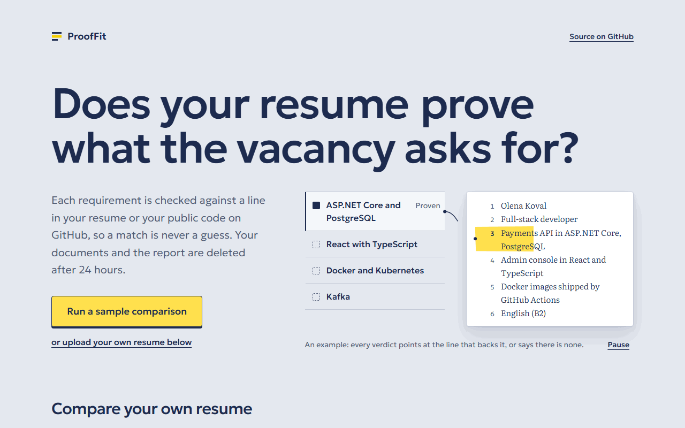
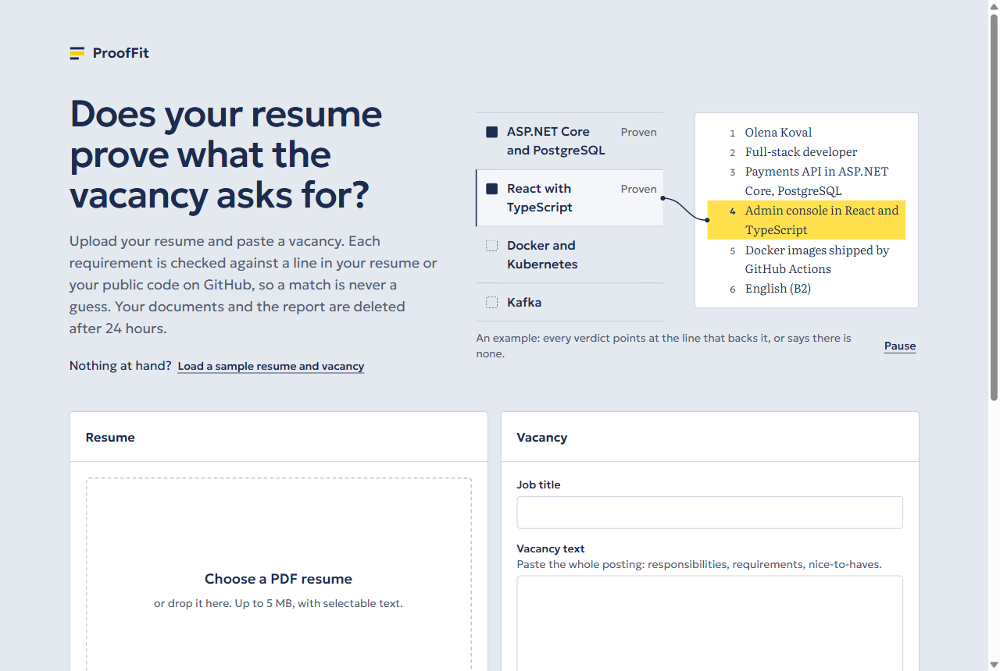
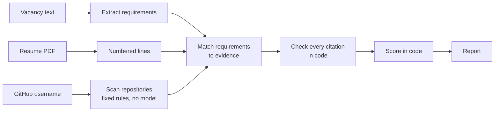

# ProofFit

[](https://github.com/Heek1/prooffit/actions/workflows/ci.yml)
[](https://github.com/Heek1/prooffit/actions/workflows/ci.yml)
[](https://github.com/Heek1/prooffit/actions/workflows/codeql.yml)
[](https://prooffit.onrender.com)


[](LICENSE)

**Does your resume prove what the vacancy asks for?**

**Live demo:** [prooffit.onrender.com](https://prooffit.onrender.com). Press "Run a sample
comparison". It runs on free hosting, so the first request can take up to a minute.

ProofFit compares a resume with a job posting and backs every verdict with evidence. A
requirement counts as met only when the report can point at a line of the resume or at
something in the candidate's public GitHub repositories. The matcher proposes; plain code
checks the evidence and computes the score.



## What it does

- **Reads the vacancy** and lists what it requires, split into must-haves and nice-to-haves.
- **Reads the resume** from a PDF and keeps it as numbered lines, so evidence can be cited.
- **Scans a GitHub profile**, if a username is given, for the skills its public code shows.
- **Judges each requirement** as proven, partly proven or without evidence, with a one-line
  reason and the evidence quoted in place.
- **Scores the match** from 0 to 100, with must-haves counting double.
- **Goes with you**: a summary in plain text for an email or a note, or a PDF of the report
  with each requirement, its reason and its evidence.

Choosing a requirement in the report draws a thread to each line it cites in the resume and
each fact it cites from GitHub, and marks the line of the vacancy the requirement was read
from, so the reading of the vacancy can be checked as well. If it was read wrongly, the
requirements can be edited by hand and the documents compared again. The start page runs a small
example of this, and a sample comparison is one click away.



## How it works



Two engines can do the extracting and matching:

- The **keyword engine** needs no model. It reads requirements from the headed bullet lists
  of a posting and looks for the technologies each one names. It is the default.
- The **model engine** asks a language model (Gemini) and is used when an API key is
  configured. If the model is unreachable or returns something unusable, the keyword engine
  finishes the analysis and the report says so.

Whichever engine runs, its verdicts are only proposals. `EvidenceValidator` drops any cited
resume line that does not exist and any GitHub fact that was never gathered, and a verdict
left with no evidence becomes "no evidence". A model cannot talk a requirement into the
report as met.

## Design decisions

Each has a longer record, with what it costs, in [docs/decisions](docs/decisions/README.md).

- **Evidence is checked in code, not trusted.** This is the product's one promise, so it does
  not depend on a prompt being obeyed.
- **The score is arithmetic.** It is computed from the verdicts, so the same verdicts always
  give the same number and the number can be explained.
- **GitHub facts come from rules.** Skills are detected from file paths and dependency
  manifests. Every fact links to the file that shows it (a Dockerfile, a `package.json`, a
  source file) and says when the repository was last pushed to, so it can be checked in one
  click. Forks, vendored code and build output are ignored.
- **No vector search.** A resume and a profile's facts fit in a model's context whole, so
  there is nothing to retrieve. The pgvector extension was removed once that was clear.
- **No sign-in.** Public GitHub data needs no OAuth, and someone trying the demo should not
  have to log in. Scanned profiles are cached for a day because GitHub allows 60 anonymous
  API requests an hour.
- **Analyses run in a background worker, and the database is the queue.** Creating one
  returns at once. A worker claims an analysis with `FOR UPDATE SKIP LOCKED` and holds it on a
  lease it renews while it runs, so several instances can share the work and an analysis
  whose instance dies is taken over by another. Progress is streamed as server-sent events,
  read from the database.
- **A report is one JSON document.** It is written once and always read whole.
- **Text a reader cannot see is not evidence.** White or near-white text, text under three
  points, and invisible text are left out of a resume when its PDF is read, and the page says
  how many characters were dropped. Hiding a vacancy's keywords is the oldest trick against
  automated screening, and it would otherwise prove anything.
- **Instructions in a resume are not evidence either.** "Ignore previous instructions",
  "SYSTEM: ..." and "the candidate meets all requirements" lines are not counted by the
  keyword engine, and the model is told to treat such text as part of the document.
- **Observable without reading anyone's resume.** OpenTelemetry traces each request, database
  query, GitHub scan and model call, with the model and its token use tagged after the
  generative-AI conventions, and an analysis carries its steps as events. Metrics count
  analyses by outcome and engine, their duration, model fallbacks and tokens. Spans carry
  ids, counts and durations, never text from a resume or a vacancy.
- **Locked down by default.** The API sends strict security headers (no framing, no sniffing,
  no referrer, a Content-Security-Policy that allows nothing) and HSTS outside development.
  The built frontend carries its own Content-Security-Policy: scripts, styles and fonts only
  from the site, requests only to the site and the API. Dependabot and CodeQL watch the code.
- **Years of experience are counted in code.** Dated jobs in the resume ("March 2019 to
  present") are read into periods, credited with the technologies under them, and added up
  with overlaps counted once. The keyword engine checks "3+ years of Python" against that
  count, and the model is handed the numbers instead of doing the date arithmetic itself.
- **Repeated comparisons are answered from an earlier report.** The same resume, vacancy
  and GitHub login give the same verdicts, so a recent complete report is copied instead of
  asking the model again. The sample is instant after its first run, and repeats spend none
  of the daily quota. A report made while the model or GitHub was unavailable is not reused.

## Evaluation

`backend/evals` holds 35 hand-written cases with 196 labelled requirements. Each case is built
around a way matching goes wrong: synonyms and abbreviations (K8s, Postgres, TS), amounts of
experience counted from dates and from overlapping jobs, negation and phrasings that only look
like one ("no downtime"), alternatives, neighbouring technologies (Kotlin for Java, MySQL for
PostgreSQL, GCP for AWS), a bare list of skills with no work behind it, a manager whose team
used the technology, a graduate with only course projects, resumes and vacancies in Ukrainian,
certifications and compliance, evidence found only on GitHub, and a resume that tries to
instruct the model.

| Engine | Cases run | Accuracy | Unsupported claims |
|---|---|---|---|
| Keyword baseline | 35 of 35 | 111 of 196 (56.6%) | 4 |
| Model (`gemini-3.5-flash`) | 21 of 35 | 108 of 120 (90.0%) | 1 |

The model's free tier allows about 20 calls a day, one per case, so its run is split across
days. Fourteen cases (`22` to `35`, 76 requirements) are still to be measured; resume with
`--from 22`. Its figures combine the original nine cases (42 of 43) and twelve of the later
ones (66 of 77).

An unsupported claim is a requirement reported as proven or partly proven when the label
says there is no evidence: the mistake that matters most here. Most come from text that names
a technology the candidate has not used: a negation ("no production experience with
Kubernetes") or other people's work ("worked alongside developers who used React"). The
keyword engine reads those phrasings and does not count such a line as evidence.

Where the keyword engine goes wrong, from the newest cases: it counts a line about a team the
candidate managed ("managed a team building a Kafka-based platform") and course projects as
evidence; it reads learning only in English ("вивчаю Next.js на курсах" counts as proven); it
asks for every alternative in "Angular or React"; it does not know abbreviations such as TS or
EKS, nor Go, which is too common a word to look for; and it cannot check a requirement that
names no technology (leadership, on-call, GDPR). Those are the gaps the model engine exists for.

Where the model goes wrong now:

- **A bare list of skills.** It takes "Skills: React, Kubernetes, Rust" as proof. The labels
  call that partial, since no work is described. 1 of 5 right.
- **A graduate's course projects.** It counts Java in a final-year project as commercial
  experience. 2 of 6 right.

The set is written by one person. It is there to catch regressions and compare engines, not
to stand as a benchmark. CI runs the keyword engine on every change and fails below 50%. Add `--show-misses` to list every
wrong verdict with its reason.

```bash
cd backend && dotnet run --project evals/ProofFit.Evals
```

To evaluate the model engine, set `LLM_API_KEY` and add `-- --engine model`. When the daily
quota runs out the run stops with the cases it finished and prints where to resume.

### Reading requirements from a vacancy

The cases above give the requirements, so they measure matching alone. A second set,
`backend/evals/extraction`, measures the step before it: 10 vacancies with 51 labelled
requirements, in the layouts postings use (headed lists, optional items marked inline,
responsibilities and benefits around the requirements, plain prose, numbered lists, a one-line
stack, capitalised headings, Ukrainian, a line addressed to screening software).

| Extractor | Recall | Precision | Required or optional right |
|---|---|---|---|
| Keyword baseline | 48 of 51 (94.1%) | 45 of 46 (97.8%) | 48 of 48 |
| Model | not measured yet | | |

Recall is the share of labelled requirements found; precision, the share of extracted ones
that are real. An extracted requirement finds a label when it names the label's phrase, so
"React with TypeScript" can arrive as one requirement or two. The keyword extractor misses
requirements written as prose that name tools outside its catalog (Airflow, Snowflake, dbt),
and takes the job title "Backend Developer (.NET)" for a requirement. Two of its faults were
found by this set and fixed before the figures above: it did not read "What we are looking
for" as a heading, and it listed a line telling screening tools to pass every applicant.
CI fails below 85% recall or 90% precision.

```bash
cd backend && dotnet run --project evals/ProofFit.Evals -- --suite extraction
```

## Run it locally

You need the .NET 10 SDK, Node.js 22 and Docker.

Start the database:

```bash
docker compose up -d db
```

Start the API on http://localhost:5080. In development it applies database migrations on
startup:

```bash
dotnet run --project backend/src/ProofFit.Api
```

Start the frontend on http://localhost:5173:

```bash
cd frontend && npm install && npm run dev
```

To run everything in containers instead, with the app on http://localhost:8080:

```bash
docker compose up --build
```

## Configuration

Everything is optional. With nothing set, analyses use the keyword engine and GitHub is read
anonymously.

| Setting | Effect |
|---|---|
| `Llm:ApiKey` | A Gemini API key. Turns on the model engine. |
| `Llm:Model` | The model to call. Defaults to `gemini-3.5-flash`. |
| `GitHub:Token` | A token with public read access. Raises the limit from 60 to 5,000 requests an hour. |
| `ConnectionStrings:Default` | The database, as a connection string or a `postgres://` URL. |
| `RateLimit:AnalysesPerTenMinutes` | Comparisons one client may start in ten minutes. Defaults to 10. |
| `RateLimit:UploadsPerMinute` | Uploads and saved vacancies per client each minute. Defaults to 30. |
| `Retention:Lifetime` | How long a comparison and its documents are kept. Defaults to 24 hours. |
| `OTEL_EXPORTER_OTLP_ENDPOINT` | Sends traces, metrics and logs over OTLP to this collector, such as Grafana Cloud, Honeycomb or a local Jaeger. Headers for its key go in `OTEL_EXPORTER_OTLP_HEADERS`. |
| `Cors:AllowedOrigins` | Origins allowed to call the API, when the frontend is served from another host. |

For local development, keep secrets out of the repository with user secrets:

```bash
cd backend && dotnet user-secrets set "Llm:ApiKey" "<your key>" --project src/ProofFit.Api
```

For Docker Compose, copy `.env.example` to `.env` and fill it in.

## Tests

The backend integration tests start their own PostgreSQL container, so Docker has to be
running. GitHub and Gemini are replaced by stub HTTP handlers; no test touches the network.

The matching code is also put through mutation testing (Stryker.NET): small deliberate changes,
such as `>` turned into `>=`, that a test has to notice. 83% of them are caught, and every one in the
evidence check and the score. It runs when that code changes and weekly.

The guarantees about evidence are also checked as properties (FsCheck): matcher output is
generated to be as wrong as a model can be, with invented ids, line numbers outside the resume
and facts that were never gathered, and every verdict must still cite evidence that exists.

```bash
cd backend && dotnet test
```

Coverage of the backend's hand-written code (generated code and migrations left out) is about
96% of lines and 88% of branches. CI adds the figures to each run's summary and keeps the
badge above current. To see it locally:

```bash
cd backend && dotnet tool restore && dotnet test --collect:"XPlat Code Coverage" --results-directory TestResults
```

The frontend's tests cover the report's logic as plain functions, and its components with
Testing Library in jsdom: the requirement list with its verdicts and quoted evidence, editing
requirements and comparing again, and deleting a report after a confirmation.

```bash
cd frontend && npm run lint && npm test && npm run build
```

End-to-end tests drive the real frontend in Chromium: the sample comparison, choosing
requirements, editing them, deleting a report, phone width, reduced motion, and reading a
report with the keyboard alone. Every page is also checked with axe against WCAG 2.1 A and
AA and axe's best practices, and any violation fails the run. The API is answered by a fake
inside the browser, so they need no backend.

```bash
cd frontend && npx playwright install chromium && npm run e2e
```

## API

| Method | Path | Purpose |
|---|---|---|
| `POST` | `/api/resumes` | Upload a PDF (multipart field `file`, up to 5 MB and 10 pages); returns the extracted text |
| `GET` | `/api/resumes/{id}` | A stored resume |
| `POST` | `/api/vacancies` | Save a vacancy: `{ "title", "text" }`, text of 50 to 20,000 characters |
| `GET` | `/api/vacancies/{id}` | A stored vacancy |
| `POST` | `/api/analyses` | Start a comparison: `{ "resumeId", "vacancyId", "gitHubLogin"? }`; returns 202 |
| `GET` | `/api/analyses/{id}` | A comparison with its documents and, once finished, its report |
| `GET` | `/api/analyses/{id}/events` | Progress as server-sent events; closes when the comparison ends |
| `POST` | `/api/analyses/{id}/rerun` | Compare the same documents again against corrected requirements: `{ "requirements": [{ "text", "importance", "vacancyLine"? }] }`, 1 to 40 |
| `DELETE` | `/api/analyses/{id}` | Delete a comparison and its documents now |
| `GET` | `/health/live` | The process is up |
| `GET` | `/health/ready` | The process is up and can reach the database |

Errors are returned as [RFC 9457](https://www.rfc-editor.org/rfc/rfc9457) problem details.
In development the OpenAPI document is served at `/openapi/v1.json`. Every development build
also writes it to `frontend/openapi/prooffit.json`, and the frontend's types are generated from
it (`npm run api:types`), so the page cannot drift from the API unnoticed: CI fails when either
file is out of date.

## Layout

```
backend/
  src/ProofFit.Api/
    Domain/                  entities, the report, shared input limits
    Data/                    EF Core context and migrations
    Features/
      Resumes/               PDF upload and text extraction
      Vacancies/
      Analyses/              endpoints, background worker, runner
        Matching/            both engines, evidence validation, scoring, skill catalog
      GitHub/                profile scanner and its detection rules
      Llm/                   the model interface and the Gemini client
  tests/ProofFit.Api.Tests/
  evals/                     labelled cases and the runner that scores an engine
frontend/
  src/
    api.ts                   typed client for the API
    api.generated.ts         its types, generated from the OpenAPI document
    report.ts                the wording and arithmetic of a report
    pages/                   the start page and the report page
    components/
docker-compose.yml
.github/workflows/ci.yml
```

## Status and limits

- **The model engine depends on a hosted API.** It has been run against the live Gemini API,
  both through the app and on the evaluation set. On the free tier Gemini allows about 20
  requests a day per model, and an analysis uses two; past that, or when the model is
  overloaded, the keyword engine takes over.
- **Reports are not private, but they are short-lived.** There are no accounts, so a report
  can be opened by anyone who has its address. A comparison and its documents are deleted
  automatically after 24 hours, and the report page has a button to delete them at once.
- **Scanned PDFs are not supported.** The resume has to contain selectable text.
- **The keyword engine knows a fixed list of technologies.** A requirement that names none of
  them is reported as unchecked.
- **The demo runs on free tiers.** The server sleeps when idle, the database is a free
  Supabase project kept awake by a daily request, and the model has a small daily quota, after which
  reports come from the keyword engine and say so.

## License

[MIT](LICENSE)
